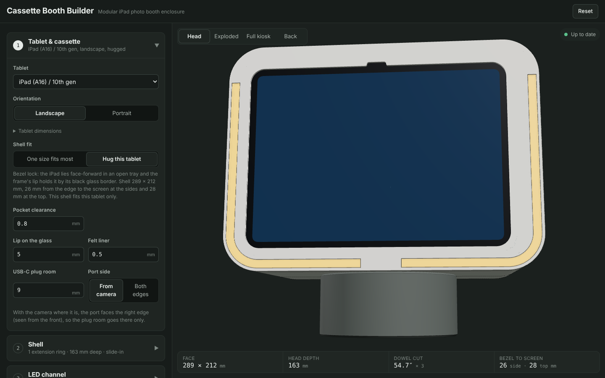

# Cassette Booth

A browser configurator for a 3D-printed, modular iPad photo booth. Pick the tablet, orientation and options, preview the head and the full kiosk in 3D, and export print-ready parts.



## Basic and Advanced

Two tabs sit at the top of the settings. **Basic** walks through eleven plain questions (which iPad, which way the screen sits, whether other iPads should fit, the USB-C dock, the light ring, how it stands and how high the camera is, room for electronics, the back panel, your printer, colors, and the download), each answered with a dropdown, a switch or a choice of buttons. **Advanced** is the full set of numbered steps with every dimension exposed. Both edit the same booth, so you can switch at any time; anything set to a custom value in Advanced shows as its own choice in Basic. The page remembers which tab you used.

## The design

- **Cassette:** the iPad lies in a tray (hugged to the tablet, or a one-size-fits-most cassette) that slides into the shell from the top. A finger scoop and a grip ridge lift it back out. The cassette's top band wraps the upper corners as a contrasting accent color.
- **Shell:** a rounded rectangle built from a front frame, a main shell (ring 1) and any number of extension rings, glued with lap joints. A 2 mm front lip holds the iPad by its glass border; the camera notch never shows the iPad's metal edge.
- **LED halo:** one unbroken U-shaped channel around the sides and bottom of the face, with a one-piece translucent diffuser, lit end to end by a single strip. The top 22 mm of each side is an unlit end bay, dug 3 mm deeper and closed by a small press-in end cover printed in the shell color, flush with the face. The strip starts on the side you pick, 8 mm in under that cover, and its lead turns in the 14 mm above into a slot straight back into the box; it runs down, across and up the other side, and its cut end tucks 8 mm under the other cover. The covers hide both ends, the solder pads and the lead. It has to bend sideways round the two bottom corners with its LEDs facing forward, so the page offers strips that do: TOPXCDZ 5 V RGB (the default: plugs into a USB controller, no soldering), DEMASLED 12 V white, BTF-LIGHTING 12 V RGB, or Adafruit's NeoPixel side-light strip standing on its edge. Picking one sizes the channel and gives the cut length in LEDs, the reel to buy and the power it needs. The cable holes in the base take a USB-A plug, so the LED and iPad cables both run down to one 2-port charger.
- **Back panel:** Thread Boards-style threaded holes, laid out in the page's grid editor.
- **Mount:** three choices.
  - **Tripod:** a drum centred under the head, with three wood-dowel legs that thread in through printed ferrules on 45-degree self-centring seats.
  - **Post:** one pole you supply (EMT conduit or a hardwood dowel) between a printed post cap under the head and a printed floor flange on a plywood base. The page sizes the base, gives the pole's cut length, how hard a push tips it, and a step-by-step guide to build the base.
  - **Wall:** the same front frame and cassette on a shallow wall case and a wall plate with two keyholes. The page gives the screw spacing and the height to hang it at.
- **USB-C dock (portrait, hugged tray):** a fixed plug in a printed clip at the bottom of the slot, so the iPad plugs itself in as the cassette drops in. Pick Apple, Anker or Amazon Basics (links to each), or measure your own plug.

Every printed part is checked to print without supports (except the universal cassette's back ledge), with no wall under 1.4 mm and no overlaps in the assembly.

## Nozzle and material

Step 6 sets the nozzle (0.4, 0.6 or 0.8 mm, default 0.8) and material (PETG or PLA). The nozzle reshapes the white shell parts: walls, ribs and lips snap to whole extrusion widths (nozzle × 1.125, at least 2 lines) and skins to whole layers (nozzle × 0.5, at least 1.2 mm), with outer size and every fit clearance unchanged. The front frame and rings get a 0.4 mm V-groove down their underside and print with it at the back of the bed, where a Rear seam lines up in it. The material only changes the slicer settings (temperature offset, max volumetric speed, cooling, ironing). The page lists what each change did before you export.

## Colors

Step 7, Colors, previews filament colors. Pick a look from the dropdown (Studio, Graphite, Sage, Clay, Cobalt, Night). Under In use, each color is listed with what it covers and how many parts ("Shell · 4 parts"); change a color there and every part wearing it changes too. Hovering a row outlines its parts in the view. To give one part its own color, click it in the view and pick from the swatches or a new color; new colors join the library. Colors travel with saves and booth codes, and the README in the download lists which parts to print in which color.

## Export

The download is a zip with:

- STLs in print orientation, full-detail threads.
- Two PrusaSlicer 2.9+ projects: one for a Prusa XL (single tool, the chosen nozzle and material) and one for a Core One (HF 0.4, the chosen material). Each loads with its printer and print presets and the Generic PETG or PLA filament preset selected (any brand) and every part already placed on its bed, across up to nine beds, with per-part settings applied.
- `instructions.html`: picture instructions for this exact booth, drawn to the visual language in `docs/instructions-style.md` (an original character and symbol set; no words needed).
- A README with quantities, hardware, print settings and assembly order, plus the settings as JSON and a booth code. Paste the code (or open the JSON) under Export, Restore a booth to bring the booth back exactly; a link ending in `#cfg=<code>` opens it too.

## Layout

| Path | What |
|---|---|
| `app/` | The configurator. `index.html` (UI, a body fragment), `app.js` (UI, three.js scene, export), `geom.js` (all geometry, on manifold-3d), `worker.js` (geometry off the main thread), `pack3mf.js` (bed packing and the PrusaSlicer 3MF writer), `printsettings.js` (slicer settings from the Nozzle and Material settings), `howto.js` (the picture instructions), `presets/` (flattened PrusaSlicer presets per printer, nozzle and material), plus vendored three.js, manifold-3d and JSZip. |
| `checks/` | Node scripts that build the parts and verify them: assembly overlaps, single-body parts, overhangs and thin walls per part, wall thickness around the LED channel, tray and base sockets, ferrule fit, and the 3MF layout. |
| `tools/build.py` | Builds the static site into `build/` (used by Netlify). |
| `tools/preview.py` | Builds and serves the configurator locally. |
| `tools/prusa/flatten.py` | Regenerates the preset configs from PrusaSlicer's `PrusaResearch.ini`. |

## Run it

```sh
python3 tools/preview.py      # http://localhost:8765/
npm install                   # manifold-3d, for the checks
npm run check                 # geometry checks
npm run check:print           # full print audit of the default hugged landscape setup (slow)
```

## Deploy

`netlify.toml` builds the site with `python3 tools/build.py` and publishes `build/`, with the right content types for the WebAssembly kernel and the preset configs. Connect the repo in Netlify (Add new site → Import an existing project → GitHub → `printabooth`) and every push to `main` deploys. Exports save as a normal browser download outside claude.ai.

## Notes

- The back panel's thread (12 mm x 1.75 on a 25 mm grid) is an estimate of Thread Boards' 12 mm screws, which aren't published. The export includes a one-hole test coupon: print it first.
- USB-C plug head sizes for the dock are typical measurements, not published specs. Measure yours and print the dock clip first.
- Tablet presets are estimates from published specs. Measure your iPad and use Custom size before a big print. The tray's pocket corners are deliberately tighter than any iPad's, so the corner radius doesn't need to be exact.
- The `.3mf` presets come from the profile bundle shipped with PrusaSlicer 2.9.7. If your installed profiles are newer, a few values may show as modified when you open a project.

## License

Proprietary. Copyright (c) 2026 Guy Meyer. All rights reserved. The public site is for interactive use only; the source code, design assets and content may not be copied or redistributed without permission. See [LICENSE.md](LICENSE.md).
